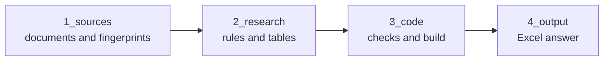

# Welfare crosswalk, dairy cows

Which signs of dairy cow welfare can a machine already measure on farms, and which do certification schemes (the standards behind welfare labels) ask farmers to show? The answer is one Excel file. It lists welfare indicators (measurable signs, such as lameness): the measures in the overview of the Welfare Quality assessment protocol, and the animal based measures (ABMs) that EFSA, the European Food Safety Authority, rates in the ABM assessment tables of its 2023 opinion on dairy cows. Beside them it lists what commercial sensors say they measure that no protocol covers, and says whether the welfare sources treat each row as a measure of welfare. It sorts them by a stated rule of thumb for ease of adoption. Every value traces to a public document.

## Start here, in plain words

**What this is.** Farms can now buy sensors and cameras that watch cows. Welfare labels, such as RSPCA Assured, send inspectors to check how cows are kept. This project takes 58 signs of dairy cow welfare that scientists use, such as lameness, and asks two things about each one. Can a machine on sale measure it? Does a welfare label require it, and how is it checked? Since 17 October it also takes the 23 other things that sensors on sale say they measure, such as rumination or body temperature, asks the same two questions, and asks a third of every row: do the welfare sources treat it as a sign of welfare at all? The answer is one Excel file, [4_output/welfare_crosswalk_dairy.xlsx](4_output/welfare_crosswalk_dairy.xlsx).

**What it has found so far.** Lameness and body condition are the two clearest cases. Every label requires both. Inspectors check lameness by hand under all four labels and body condition under three; Certified Humane does not say how it checks body condition. Yet a sensor on the market has been tested in a published study for each. Nine other signs are measured by a sensor on the market, or claimed to be, but no label asks for them; three of these were found only by reading the studies and makers' pages since 2021. No label's numbered rules accept sensor data as the way an inspector checks any of the 58 signs. For 43 of the 58 signs, none of the 129 products listed in the 2021 sensor review, the market as it stood in 2020, says it measures them, and for one more, thermal comfort, it is unclear. Here label also covers FARM, the US dairy industry's own programme. Of the 23 things sensors measure beyond the protocols, 11 are linked to welfare by the welfare sources, 5 have a link the sources question, such as milk yield, and 7 have no link in the sources at all, such as location; twelve of them are measured but required by no label.

**How to read the Excel file.** Open the sheet called Answer. Each row is one welfare sign. Read it from left to right: the sign, its welfare state, whether the welfare sources treat it as a welfare measure, whether a sensor can measure it, how easy it would be to adopt, and which labels require it. The last columns name the documents and pages behind the row. These are the words the file uses:

| You see | It means |
|---|---|
| Tested | A product on the market measures this sign, and a published study recorded in the 2021 sensor review tested it |
| Claimed | A product on the market says it measures this sign, but no study of it is recorded |
| Shown in research | No product in the 2021 sensor review says it measures this sign, but a study the sensor papers cite measured it in cattle |
| Proposed only | No product in the 2021 sensor review says it measures this sign; scientists have only proposed a way, shown one in another species or setting, or offered a related sign in its place |
| Nothing found | The two sensor papers this project reads, from 2020 and 2021, name no way to measure it |

The same words are used for a second grade, from studies and makers' pages since 2021, with the sources set out in [rules.md](2_research/rules.md), rule 4.11; the Excel file shows both grades and uses the stronger of the two for the score and Kevin's lists.
| Unclear | The written rules do not settle the answer; the question is listed openly in [open_questions.md](2_research/open_questions.md) |
| Required | A label's numbered rules require it on every farm the label certifies |
| Checked by hand | The label's inspector looks at the cows or their housing and equipment, or reads the farm's records |
| Established | Column (1): a welfare protocol lists it as a measure taken on the animal (an established input: a measure of the housing or management) |
| Supported, Indirect or contested | Column (1): a welfare source links this sensor parameter to welfare; or a source says that link is unclear, insufficient alone or debated |
| No welfare validation, Not framed as welfare | Column (1): no welfare source links it to welfare, though a product or a label treats it as about health or welfare; or no one does |

**How to check one row yourself, with no code.** Pick a row in the Answer sheet. Its last columns name a document and a page. Open that document at that page and find the sentence the row relies on. Then read the rule the row names in [rules.md](2_research/rules.md) and ask whether the label in the row follows from that sentence. If it does not, that is an error, and it should be reported.

**Product links.** The Product list sheet gives, for each of the 129 products, the link the Stygar team printed in 2021 and what it opens today. When the links were checked on 15 October 2026, 35 still opened a maker's page naming the exact product (16 directly and 19 after being sent on to a new address), 38 opened the wrong page, such as a page for the product family, a dealer's page, a domain held for sale or an unrelated site, and 56 were broken. Where the old link fails, the sheet gives the maker's current page if one was found. [2_research/product_links.csv](2_research/product_links.csv) holds the same, and [4_output/found_along_the_way.md](4_output/found_along_the_way.md) describes what the check found, with other places where the sources disagree.

**Everything is in this repository.** Every fact, rule and decision this work rests on is written down here, with the date it was made. No other repository, notes or person is needed to check it. The only things not stored here are 72 published documents and saved web pages that are not copied into this public repository, because of their owners' terms or, for one paper, a download stamp that identifies whoever downloaded it. Each has a link and a fingerprint, a code that proves a downloaded copy is the exact document the research read. For some of them a fresh copy cannot match byte for byte; [1_sources/README.md](1_sources/README.md) says how those are checked instead.

**Running the checks again.** This needs Python on the computer. From the top folder of the repository, run these four commands in order. The first installs two helper libraries; the second downloads every document it can, proves each copy, and lists any to save from a web browser; the last two check the tables and confirm the Excel file matches them.

```
pip install openpyxl pypdf
python 3_code/check_sources.py --download
python 3_code/check_tables.py
python 3_code/build_output.py --check
```

One site, the FARM programme, refuses downloads made by a program. The second command prints its link, to open in a web browser and save into the folder 1_sources under the name it gives. The two saved web pages are not downloaded, because a copy saved today cannot match; `python 3_code/check_sources.py --only icar_validated_sensors.html wieck_2026_moral_catastrophe.md` checks them against their live pages.

## The question

Kevin Xia put this on his Top 30 list of projects as item 13 ([his text](1_sources/kevin_item_13.md)). He asked for a three way crosswalk for one species: validated welfare indicators, against what commercial farm sensors measure, against what certification schemes require and audit. The most useful results, he wrote, are indicators a sensor already measures but no scheme requires, and indicators a scheme requires but checks by hand.

On a call on 22 September 2026 Kevin proposed a smaller table of indicators that are measurable by AI (artificial intelligence), acceptable to industry and covered by certification schemes. The record of the call is a set of notes written automatically by a meeting tool, not Kevin's own words ([automated call notes](1_sources/kevin_call_2026-09-22.md)). The three part question this project answers, (a) measurable by AI, (b) acceptable to industry and (c) covered by existing sensors or certification schemes, is that proposal as Manisha wrote it up on 23 September and sent to Kevin. His Slack reply of 25 September ([his reply](1_sources/kevin_slack_2026-09-25.md)) quotes the parts he answers. In that reply he calls industry acceptability, "covered by existing sensors" and "covered by existing certification schemes" soft factors that make adoption easier, not hard requirements. Item 13 itself has no (a), (b), (c) list. So every indicator stays in, sorted, with each factor visible.

Item 13 names three kinds of source for validated indicators: Welfare Quality, AWIN and the species literature. This project uses Welfare Quality and the EFSA opinion on dairy cows, a choice carried over when this repository was set up on 25 September 2026 (decision_log.md, first entry). [rules.md](2_research/rules.md), rule 4.1, says exactly which measures are in. Kevin's change request of 7 October notes that the choice was carried over rather than argued. AWIN is not used for this dairy unit. EFSA rates each of its measures for feasibility, sensitivity and specificity, and some ratings are low. It rates lying time low on feasibility on farm, for example. Since 8 October these ratings are in the table, using EFSA's own level words (high, medium, low; mixed where EFSA gives two levels and not stated where it gives none), for every indicator that comes from EFSA.

## The answer

The answer is [4_output/welfare_crosswalk_dairy.xlsx](4_output/welfare_crosswalk_dairy.xlsx), in eight sheets. **Read me** explains the file and gives the current counts. **Answer** has one row per indicator, sorted by the ease of adoption score, a rule of thumb used only as a sort order and not a recommendation; every factor has its own column. **Sensors x products** sets each indicator against the 129 sensor products listed in a 2021 review by Stygar and colleagues, marking which a published study has tested and which only name it in their own description. **Schemes** sets each indicator against four schemes: RSPCA Assured, FARM version 5 (the US dairy industry's own programme), Global Animal Partnership and Certified Humane. **Product list** is the Stygar list of 129 products as it stood in 2021. Three more products, validated by ICAR (the International Committee for Animal Recording), are not in that list; they are in [2_research/products.csv](2_research/products.csv). **By welfare state** reads Kevin's two lists once per welfare state. **Evidence since 2021** gives the quality record of every study and maker's page behind the grades since 2021. **Sources** lists the documents.

Read a row of the Answer sheet from left to right. After the indicator, which source lists it (or Sensor side only) and what kind of thing it measures come its welfare state, column (1) on welfare relevance with the passages it rests on, and EFSA's three ratings, blank for indicators that EFSA does not list. Column (a) says whether a sensor can measure the indicator, and which tested products do. Column (b) gives the cheapest device needed, how many of the 129 products name it, and whether FARM names it. Column (c) gives how many schemes require it and how they check it. The sensor half of (c), covered by existing sensors, is not a separate column: it shows in column (a) and in the count of products that name the indicator. Then come Kevin's two lists, a score from 0 to 15 (a sort order, not a welfare judgement) with its five parts, and finally the documents and pages behind the row.

One pairing can look odd. Device needed can read "Nothing extra" even where column (a) says "Nothing found" for sensors. That happens when the indicator is already taken from milk records or farm records, such as a count of clinical cases, so no new device is needed to have the value.

## Answers so far, as of 17 October 2026

The table has 81 rows. 58 come from the two welfare protocols: 26 listed only by EFSA (in its 2023 opinion on dairy cows), 26 only by the Welfare Quality protocol, and 6 by both. For the 32 that come from EFSA, the table also gives EFSA's own ratings of each measure: sensitivity (does it catch the animals that have the problem), specificity (does it avoid flagging animals that do not) and feasibility on farm. The other 23 rows are the sensor side, added on 17 October as Kevin's change request of 7 October asked: one row for each kind of parameter that the sensor products in the Stygar list say they measure and that no protocol row covers, such as rumination, body temperature, location, milk yield and oestrus. Every parameter named in the 129 product descriptions is covered, by a protocol row or a sensor side row, except one description that names none ([rules.md](2_research/rules.md), rule 4.12).

Column (1), new on 17 October, says whether the welfare sources treat each row as a measure of welfare ([rules.md](2_research/rules.md), rule 4.14). The 48 protocol rows that measure the animal are established; the 10 that measure the housing or the management, or a criterion with no measure, are established inputs. For the sensor side, three sources were searched in full for every sentence about each parameter: the EFSA opinion, the Welfare Quality protocol and Linstädt and colleagues 2024, a systematic review of welfare indicators for dairy cows. 11 sensor side rows are supported (a source links them to a welfare problem and none questions the link, for example rumination, body temperature and body weight), 5 are indirect or contested (a source says the link is unclear, insufficient alone or needs validation: feeding time, a general health status, a welfare status, standing and milk yield), 4 have no welfare validation (a product's description or a scheme treats them as about health or welfare, but no source links them: inflammation found by thermal imaging, LDH in milk, animal identification and milk fed to each calf) and 3 are not framed as welfare by anyone (individual water intake, location and blood in milk). Column (1) is shown beside the score and the lists and changes neither.

Sensors are checked for all 81. On the 2021 baseline, 13 have a product in the Stygar list that a published study tested for that measure, 18 are claimed by a product's own description with no validation study recorded, 2 have no product but were measured in cattle in a study the sensor papers cite, 22 have only a proposed method or a related measure, 19 have nothing in the two sensor sources, and 7 are unclear. Every sensor side row is at least claimed, because products name it. A second grade from studies and makers' pages since 2021 (rule 4.11) is kept beside the baseline, and the score and Kevin's first list use the stronger of the two: 18 tested, 17 claimed, 3 shown in research, 27 proposed only, 9 nothing found and 7 unclear. Two points of the grade since 2021 are provisional until Kevin answers: whether a study found one step through a review counts, and whether a test the maker took part in counts as a test.

The four certification schemes have been read for all 81 rows, 324 scheme rows in all. On the protocol side, RSPCA Assured requires 22 of the 58 indicators, Global Animal Partnership 18, Certified Humane 13 and FARM 8; 25 are required by at least one scheme. On the sensor side three rows are required: animal identification (FARM and Global Animal Partnership), feed availability at the feed fence (RSPCA Assured, Global Animal Partnership and Certified Humane) and milk fed to each calf (all four). No scheme's numbered standards accept sensor data as the way the inspector checks any row. Two Global Animal Partnership passages outside its numbered standards allow it: a note under standard 7.D.2 allows automated checks of electrical conductivity or light emission through milk for finding clinical mastitis cases (PDF 42), and item 3.i of its Program Requirements says video technology can be used in place of "certain observations", without naming which (PDF 5, printed v).

Kevin's first list, rows graded Tested or Claimed that no scheme requires, has 21 rows. Nine are protocol indicators: step activity (I008), lying time (I012), frequency of lying bouts (I013), subclinical ketosis from milk constituents (I021) and from beta hydroxybutyrate or ketones (I022), subacute ruminal acidosis from milk constituents (I025), rumen pH by bolus (I027), digital dermatitis (I002) and bacterial culture of milk samples (I059). Twelve are sensor side rows: rumination, feeding behaviour and feeding time, individual feed intake, individual water intake, body temperature, inflammation, location, oestrus detection, milk electrical conductivity, blood in milk, LDH in milk and body weight. Read column (1) beside them: the list includes parameters that no welfare source links to welfare, which is a finding about what the market measures, not a set of welfare indicators the schemes have missed. Twelve more are unclear: four because the rules do not settle their sensor evidence (walking distance, walking speed, thermal comfort and blood calcium), and eight sensor side rows because a scheme requirement may name them (pregnancy and reproductive status, calving, a general health status, a welfare status, nutritional status, standing, milk yield and rumen acidosis). Kevin's second list, rows a scheme requires and checks by hand, has 24: 22 protocol indicators, plus animal identification and milk fed to each calf.

Some rows test the same welfare state, for example EFSA's three tests for subclinical ketosis. Each row now carries its welfare state, read from EFSA's own table headings or the Welfare Quality criterion (rule 4.13), and the sheet By welfare state reads the lists once per state: 15 of the 45 states are on the first list and 10 are unclear; 15 are on the second list and 9 are unclear. Read that way, subclinical ketosis is not on the first list, because schemes require body condition scoring (I023), one of its three tests, even though its milk tests are measured by sensors and required by no scheme.

Two indicators stand out on the protocol side. Lameness (I001) and body condition score (I023) are required by all four schemes, and each has a product that a published study tested. All four schemes check lameness by hand. Three check body condition by hand; Certified Humane requires it but does not say how it is checked. So both are on the second list and not on the first, and they share the top score of 13.

The 2021 baseline rests on the products and studies in Stygar and colleagues 2021 and the research methods in Maroto Molina and colleagues 2020. Kevin's change request of 7 October ([his document](1_sources/kevin_change_request_2026-10-07.md)) said this baseline understates what sensors can measure. The pass of 16 October read five reviews since 2021, a bounded search for the milk and metabolic rows ([its record](2_research/bounded_search_2026-10-16.md)) and makers' current pages; every study used has a quality record on the sheet Evidence since 2021. A cross check of the baseline against Leliveld and Provolo 2020 found no disagreement ([the check](2_research/baseline_crosscheck_2026-10-16.md)).

Some cells are open. [open_questions.md](2_research/open_questions.md) has 43 lines: 2 closed and 41 open. On the protocol side, 7 are open on the 2021 sensor evidence (I006, I009, I013, I020, I039, I057 and I058), 6 on the evidence since 2021 (I006, I010, I039, I045, I056 and I058), 4 on device needed (I043, I044, I047 and I059) and 5 on scheme rows (I036 and I037 for Certified Humane, I038 for RSPCA Assured, and I048 for Global Animal Partnership and Certified Humane), each of whose indicators is already on the second list through another scheme. On the sensor side, 16 are open on scheme rows, most on the same few points the reading rules do not settle, such as whether a general health inspection names a general health status, and 3 on the evidence since 2021 (I062, I065 and I080), where the 2021 grade stands either way. An open scheme row is not counted as required.

Every push has been allowed by a PASS row in [audit_log.md](2_research/audit_log.md). The push gate allows a push only when that file has a PASS row for the commit pushed, or for its parent when the push only adds that row. The numbers on this page are updated with each batch of work. The Read me sheet of the Excel file is always current, because a script writes it from the tables.

## What this does not show

The sensor evidence starts from a baseline in two papers: Stygar and colleagues 2021, and Maroto Molina and colleagues 2020. Their products and studies are as those papers found them. The web links Stygar printed were checked again on 15 October 2026 (see Product links above). "Nothing found" in the baseline means no product or method in those two papers, not none anywhere. The second grade, since 2021, reads named reviews, a bounded search and makers' pages, not the whole literature or market.

Column (b) measures how cheaply and easily industry could adopt a measure, not whether industry would accept it politically. A cheap camera that makes lameness visible may be less welcome to industry than an expensive collar that raises production. A high column (b) means industry could do this cheaply, never that industry will not object, as Kevin's change request of 7 October asked this file to say.

Column (1) for the sensor side rests on three sources only, the EFSA opinion, the Welfare Quality protocol and Linstädt and colleagues 2024, as Kevin's change request named them. A row with no link in them may have one elsewhere. These sources are about adult dairy cows, so they say nothing about the calf row (I082).

"Validated" has a narrow meaning here. It means Stygar record at least one outside study of that product on that measure. It does not mean the product is accurate. Stygar placed every tool for physical condition and health below their high performance threshold.

Every indicator has a sensor row. Since 16 October the grades also draw on studies and makers' pages since 2021, and two points of that pass are provisional until Kevin answers, so the order may still change. The schemes were read as written: a scheme counts as requiring an indicator only when a numbered requirement names it and applies to every certified farm, under the fourteen reading rules in [rules.md](2_research/rules.md), rule 4.8. Global Animal Partnership is read at Step 1, the level every certified farm meets.

No review of the table by a welfare scientist is recorded in this repository. The checks described below are by scripts and by an AI agent, not by a person with expertise in animal welfare.

## How it was done



1. **Sources.** 74 public documents and saved web pages, each in [manifest.csv](1_sources/manifest.csv) with its link and a fingerprint: a code computed from the file that changes if one character changes.
2. **Rules.** [rules.md](2_research/rules.md) says how every column is filled and scored. It was first fixed on 25 September, before any sensor row was graded, with the indicator and product tables carried over when this repository was set up on 25 September 2026 (decision_log.md, first entry) and corrected since. The rules have been changed since, and each change is dated in the change log at the end of rules.md. Some changes moved scores: corrections of 2 October under the farm records rule raised the scores of I020, I024, I028 and I029. I006 was briefly raised on 2 October and returned to farm_fixed on 3 October, because EFSA's definition does not take it from records, so its score is unchanged from the published version.
3. **Tables.** Six tables in [2_research](2_research) hold the research; product_links.csv records what the Stygar product links open today, and evidence_since_2021.csv the studies and makers' pages since 2021. Each sensor row names the documents behind it, with pages where a passage is cited; rows resting on an absence say what was searched. Each indicator row names the measure as its source names it, and every EFSA row names its EFSA table, but not every indicator row gives a page. Each scheme row says whether the scheme requires the indicator and, where a requirement is quoted, gives its section and page.
4. **Checks.** Scripts check the tables, fingerprints and vendor counts. Before a batch is pushed to GitHub, an AI agent (Claude, a language model, working from a fixed checklist in [.claude/agents/research-auditor.md](.claude/agents/research-auditor.md)) rereads the cited pages and checks each claim. It is a separate session from the one that wrote the rows, but it is not a human reviewer. [audit_log.md](2_research/audit_log.md) lists every version that passed, with what the audit checked and found. After each push the author also plans to read ten rows against the source pages; that spot check is planned and none is logged yet.
5. **Excel.** [build_output.py](3_code/build_output.py) writes the Excel file from the tables. Nothing in it is typed by hand.

## How to check anything yourself

Every value can be checked in one of three ways: read the page the row names, apply the written rule in [rules.md](2_research/rules.md) to what the page says, or count again, by hand in the Stygar spreadsheet or with a script. Cells marked unclear, nothing found or not yet checked say openly what is not known. [2_research/README.md](2_research/README.md) explains the three ways in more detail. Two of the 74 documents in the manifest, the Stygar paper and its spreadsheet, are in this repository. The others are downloaded from their links, one at a time or all at once with `python 3_code/check_sources.py --download`. For most of them the fingerprint confirms you have the same file; [1_sources/README.md](1_sources/README.md) gives the exceptions (the ICAR web page and the Wieck essay are checked by a phrase, and the Maroto Molina paper by its text).

## The four folders

- [1_sources](1_sources): the documents, their links and fingerprints, and what Kevin sent, as received.
- [2_research](2_research): the rules, the six tables, the decision log, the audit log and the notes on the searches.
- [3_code](3_code): the scripts, each with a plain explanation at the top.
- [4_output](4_output): the Excel answer, and [found_along_the_way.md](4_output/found_along_the_way.md), the places where the source documents disagree with themselves, with each other or with the web today.

## Status, credits and licence

Work in progress. Dairy cows come first. Kevin agreed to broilers, or maybe laying hens, as the second unit. Author Manisha Sarkar. Mentor Kevin Xia. Sentient Futures incubator, 2026. Everything needed to check this work is in this repository.

Data and text written for this repository are licensed CC BY 4.0, and the code is MIT. Source documents keep their owners' terms, and Kevin's words in 1_sources are not covered. See [LICENSE](LICENSE).
